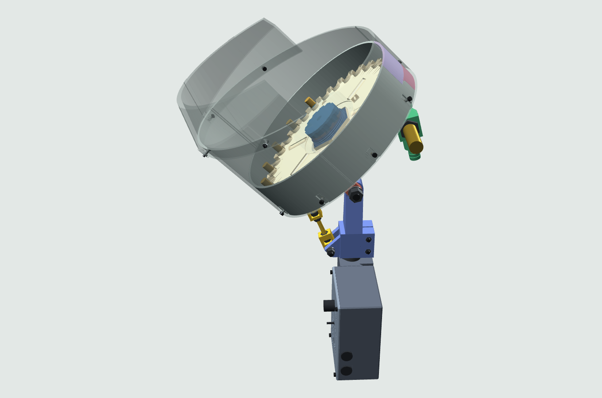

# Feeder

<picture>
  <source media="(prefers-color-scheme: dark)" srcset="guide/assets/feeder-dark.png">
  
</picture>

A tilted plate turns under loose pistol brass, and the cases leave base down through a drop tube and a hose. Every part is generated from `feeder/config.py` with [build123d](https://github.com/gumyr/build123d) and exported as STL and STEP for your printer.

Status: early development. No feeder has been built from these files yet, so parts are UNTESTED until printed.

For reloaders who 3D print their own tools and can buy a gear motor, an M18 inductive sensor and metric DIN/ISO hardware. The default feeder holds up to 250 9mm cases and prints on a 256 mm bed. Plates for 18 pistol and revolver calibers fit the same body. Press adapters for the hose are not built yet ([#7](https://github.com/OpenReloading/Feeder/issues/7)).

## Try it

Install the [Dev Container CLI](https://github.com/devcontainers/cli) and podman (or Docker without `--docker-path podman`), then:

```
devcontainer up --docker-path podman --workspace-folder .
devcontainer exec --docker-path podman --workspace-folder . .venv/bin/python build.py --no-test
```

The first command creates the container. The second writes every part to `build/<name>.stl` and `.step`, and to `build/print/` in print orientation.

To skip the build, use the [configurator](https://openreloading.github.io/Feeder/configurator/): it lists the parts for your options and zips the print files in your browser.

## Next

- [Build guide](https://openreloading.github.io/Feeder/): BOM, assembly steps, wiring, tilt and troubleshooting.
- [docs/development.md](docs/development.md): all build flags, the guide site, tests and the simulation.
- [docs/design.md](docs/design.md): every option in `feeder/config.py`, the parts with their hardware, plate sets and the tilt mount.
- [Issues](https://github.com/OpenReloading/Feeder/issues): [#3](https://github.com/OpenReloading/Feeder/issues/3) lists what a first print has to test.

MIT license, see `LICENSE`.
